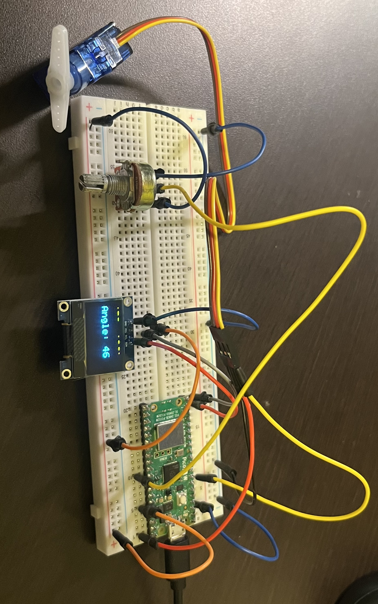

# Servo Potentiometer OLED Controller

## Overview
This project uses a Raspberry Pi Pico 2 W to control an SG90 servo motor using a potentiometer. The potentiometer position is read using the Pico's ADC, converted to an angle, and used to command the servo. An SSD1306 OLED display shows the current ADC reading and servo angle in real time.

## Hardware
- Raspberry Pi Pico 2 W
- 2G90 Servo Motor
- SSD1306 128x64 I2C OLED Display
- 10k$\Omega$ Potentiometer
- Breadboard
- Jumper Wires

## Wiring
**Potentiometer**
- VCC - 3.3V
- GND - GND
- Wiper - GP26
**OLED**
- VCC - 3.3V
- GND - GND
- SDA - GP14
- SDL - GP15
**Servo**
- Signal - GP5
- VCC - VBUS
- GND - GND

## Features
- Reads analog input from potentiometer
- Converts ADC readings (0-4095) into servo angles (0-180)
- Generates servo control PWM signals
- Displays live data on a 128x64 OLED display
- Demonstrates ADC, PWM, I2C communication in a single project

## Results
The servo successfully tracks potientiometer position and achieves approximately 170 degrees of travel while displaying real time postion information on the OLED.

## Future Improvements
- Add Ultrasonic distance sensor
- Display sensor data on OLED
- Create radar scanner using
    - Servo
    - Ultrasonic Sensor
    - OLED display
- Add menu system and multiple display modes
